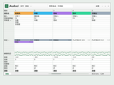

# 表格 · Sheet

以电子表格形式呈现声核的通道、效果器和路由。支持中文、English、日本語，以及明暗主题。



## 使用

当前皮肤版本为 **0.4.16**，接口要求为 Skin API **1.0**，适用于启用网页皮肤支持的 Windows x64 声核。安装后在声核的皮肤设置中选择“表格”。宿主负责音频处理、设备配置、标准菜单与工程保存。

此仓库公开现有版本的源码和独立打包方法。它不代表新的官方在线版本已经发布；在线目录仍以声核官方签名列表为准。

## 独立打包

安装 **Node.js 24.12.0**，不需要 npm 依赖、C++ 编译器或声核私有源码。

```sh
git clone https://github.com/audcore/audcore-skin-sheet.git
cd audcore-skin-sheet
node --test tools/build-package.test.mjs
node tools/build-package.mjs . dist
```

输出：`dist/cn.audcore.routing-matrix-v0.4.16.skin.audcore`。

这是网页资源的 ZIP 包，由声核按内容识别。请在声核中安装运行；直接用浏览器打开 HTML 不提供模拟宿主。

## 项目结构

- `manifest.json`：身份、版本、国际化信息、窗口设置和构建规则的唯一来源。
- `web/`：界面和宿主桥接代码、图标及封面；全部资源随包交付。
- `tools/`：无需外部依赖的静态网页皮肤打包器、包校验器与构建测试。
- `LICENSE`：MIT 许可证，适用于本仓库源码及随附自制资源。系统字体只按名称引用，不随包分发。

打包文件由 `manifest.json` 的 `build.files` 显式列出，打包器不会扫描并包含整个仓库。包内运行清单自动剔除 `build` 字段。

## 修改与发布

保留皮肤 ID，修改版本号后再交付新版本；派生为另一个皮肤时使用自己的 ID。新增文件必须加入打包清单。修改语言声明时，确认界面确实支持相应语言。

官方收录登记与构建约定见 [皮肤登记与发布规范 PR](https://github.com/itorr/audcore-document/pull/13)，合入后在资料仓库的 `skins.md` 和 `docs/皮肤发布规范.md` 维护。作者通过 tag 提供候选，官方固定到提交后审核、构建、打包及发布。已发布版本不能用不同内容覆盖。

首版独立源码调整了共享模块的相对路径，并移除其他布局及浏览器模拟的可选加载入口。0.4.16 移除皮肤中重复的图标名称映射，通道视觉名直接使用宿主推送的 `channelLabels`，语言及自定义名称规则由宿主统一处理；等待名称更新时保留已显示的内容。构建产物按实际版本交付，不覆盖历史官方版本。

当前已完成包格式、资源引用、版本及确定性打包检查。真实宿主的启动和交互验收仍需由发布流程完成；本次开源没有重新启动宿主或替换运行中的皮肤。

## 反馈与许可

请在本仓库 Issues 反馈皮肤问题。声核本身的问题请提交到 [声核问题反馈](https://github.com/itorr/audcore-document/issues)。

Copyright (c) 2026 itorr / 17o2r. Released under the MIT License.
